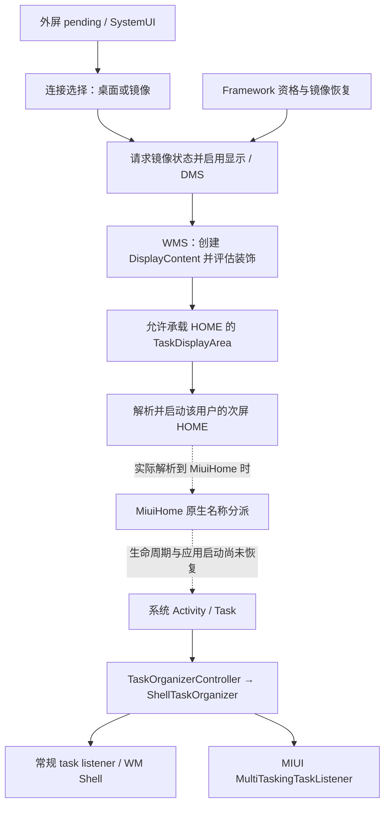

# 08 原生外接桌面：调用链与窗口职责

2026-11-11，原生计划阶段 2。**静态分析 `PARTIAL`，真机 `NOT_RUN`。** 已定位系统启动 HOME、MiuiHome 的原生名称分派、共享任务组织器和兼容缩放规则来源。HOME 生命周期、配置传播和实际窗口写入归属仍未闭合。[新增方法与 ELF 锚点](../analysis/evidence/native-desktop-stage2.json)；F 编号见[首轮证据](../analysis/evidence/findings.json)。

箭头表示静态职责及条件下的调用关系，不承诺跨进程回调的实时顺序。普通 Activity 可独立于 HOME 验证。

| 节点 | 静态已证实 | 仍待确认 |
|---|---|---|
| SystemUI 连接选择（N03、N04、N13） | `ConnectingDisplayViewModel` 用 `DesktopState.canEnterDesktopMode()` 决定对话框资格，自动选择路径还检查 display 0。`ExternalDisplayConnectionDialogDelegate.onCreate` 在 kiosk 或不支持时隐藏桌面按钮且不绑定其监听器；镜像有独立监听器。选择处理涉及 secure 镜像设置和目标显示启用请求 | 实际 pending 分支、有效资格及是否被 DMS 恢复镜像。相关 coroutine 常规反编译存在重组问题，引用分支用 fallback 核对 |
| WMS 与 HOME（N01、N02、F17/F18） | `onDisplayAdded` 创建 `DisplayContent`、更新装饰判定，然后在 booting/booted 时发起 HOME 与装饰通知。次屏 HOME 检查 TDA、多显示、设备设置完成、CE 解锁（背屏有独立路径）、有效显示与 HOME 支持；新内容模式下还查 `canHostTasks()`。解析考虑有效的自定义 HOME，再查主 HOME 包内的次屏匹配，必要时回退到配置包。通过校验后，`ActivityStartController` 按目标 TDA 启动 | 实际用户、Overlay、OEM stub 对 intent 的影响、最终解析结果与拒绝原因 |
| MiuiHome 原生分派 | manifest 中主 Launcher 与次屏 Launcher 都无单独进程声明，次屏未声明 `configChanges`；这提供默认同进程线索，不证明配置隔离。应用 metadata 选择 `libapp_launcher.so`；`hyperos.rustruntime.v5` 注册 XML 指向共享 JAR。ELF 把完整组件名送入 47 字节比较，匹配进入独立描述符分支；另有 `SecondaryDisplayLauncherUi` 的数据重定位 | `onCreate`、重建、应用启动、display context 和密度传播；同进程是否共享手势或 UI 状态。分派证据不证明组件已实例化或具有任务栏 |

## 任务与窗口职责

| 位置 | 已定位的职责 | 路线影响 |
|---|---|---|
| `system_server`（N05） | `TaskOrganizerController` 接收有任务权限的 organizer 注册、维护注册队列和任务状态，当前 organizer 查询取队尾；WMS 负责显示、TDA、task、焦点与启动约束 | 两套产品窗口体系并不等于两个互相隔离的系统 organizer；实际注册实例待核实 |
| 共享 WM Shell（N06、N07、N14） | `ShellTaskOrganizer` 经 `ShellInit` 注册；普通 listener 按 launch cookie、待关联任务、任务或父任务 ID、windowing type 分配。`appeared/infoChanged/vanished` 也分发给非空的 MIUI multitasking listener；后者传给 MIUI repository、桌面/无极窗口 stub，部分事件进入 MIUI 装饰处理 | **同一任务可被两条链观察。** 这证实通知重叠；尚未证实两边会同时写 bounds、surface 或 transition |
| AOSP 桌面分支（N08、N09、N14、F07/F08） | SystemUI 的生成组件同时包含 AOSP 装饰与 MIUI listener 的 provider。AOSP 的事件和窗口组件各有创建条件；桌面任务控制器的初始化回调另查资格。`DesktopDisplayEventHandler` 注册显示回调；`onDisplayAdded` 针对非默认屏尝试更新外屏窗口模式，也重新评估默认屏；创建桌面另查目标屏资格 | 不能把晚改标志当成重建 Shell。即使目标为外屏，也要验证默认屏行为 |
| MIUI 窗口分支（N07、N16、N17、F16） | MIUI 分支同在 Shell 注入图；服务端有按任务 `displayId` / `DisplayContent` 查询小窗的路径，但 `MiuiFreeFormGestureController` 明确依赖默认屏。MIUI desktop 有自身属性与设置门槛 | 按屏查询不证明手势、动画与装饰都支持外屏。路线 A 的外屏窗口证据不足；路线 B 的共存条件未闭合 |

## 应用缩放边界

`MiuiSizeCompatService` 创建 `MiuiExternalScreenCompatController` 并注册 `MiuiSizeCompatInternal`；manager 从该服务取配置，按包/Activity 匹配并缓存（N10–N12、N15）。parser 比较 `/product/etc/external_screen_compat_list.xml` 和 `/data/system/cloudFeature_external_screen_compat_list.xml` 的有效性与版本。七个分区文件索引及 product 对应路径未找到预置列表；设备 `/data` 未检查。

`ExternalScreenCompatPolicy.shouldApplyScaling` 还要求 folded 状态、非 multi-window、非 MIUI hover 和有效父 bounds；按方向/比例计算后写 Activity 的逻辑 bounds，manager 另处理 Insets。此判定没有单靠 `Display.TYPE_EXTERNAL` 通过的条件。**它不能作为外接显示器镜像黑边或物理模式的修复开关。**

## 复查与暂停点

- `libapp_launcher.so` SHA-256 `971e62def084aa58848ac3c061f030794afbc42020f5cb7a9e7b1582c07286db`。类名文件偏移 `0x265279`，比较 `0x94e444`，匹配分支引用 `0xe1d318` / `0xe3f2a0`。`.rela.dyn` 的 `0xe7e178` 指向 `0x266097` 的 UI 名称。导出 `app_entry_point` 位于 `0x9c491c`，尚未连通到具体 lifecycle 入口。
- `rustruntime_cfg_v3_v5.xml` 位于 `mi_ext/product/etc/permissions`，SHA-256 `584ba34f70a7d4afbabcd8653162f6af984a6ff26d738c3cd7b16a82a7d5677a`。完整反编译、反汇编与筛选日志留在 `analysis/local`。
- 后续可离线追踪两个原生描述符的调用者与生命周期表、`ActivityTaskManagerServiceStub.setHomeActivity` 的具体实现、Shell 两侧对同一 transition 和 bounds 的写入点。实际进程与类加载器、主次屏配置和窗口归属仍需授权后的运行时证据。
- 阶段 3 可以完成条件设计；这些缺口未关闭前不制作补丁，不叠加全局开关。
